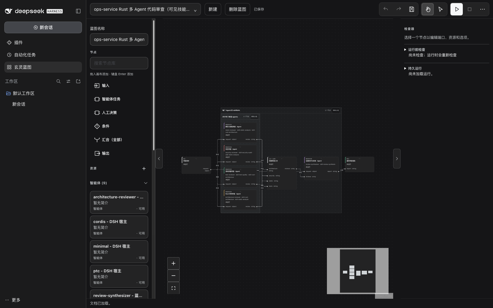

# XuanLing for DeepSeek Harness

English | [简体中文](README-ZH.md)

XuanLing for DeepSeek Harness adds XuanLing's proposal-first Memory and typed tool catalog to a DSH
profile while DSH keeps its native tools, approval flow, and UI.

## What this is

XuanLing is a local MCP server for coding agents: 43 typed tools over stdio, including 17 filesystem
tools with SHA-256 preconditions, a nine-tool proposal-first Memory v2 lifecycle, process and project
execution, artifacts, and long-running sessions.

This repository packages it for DeepSeek Harness as four bundles and one optional Blueprint plugin. A
runtime bundle mounts the XuanLing server in a DSH profile through DSH's official MCP bridge and keeps
every native tool. The model initially sees only `mcp_catalog__xuanling` and activates exact XuanLing
tools when a task needs them, so the initial schema stays small. Packages install from the public npm
registry into the profile; no global package or install-time binary download is involved.

Use it for memory that cannot become canonical without review, SHA-256-guarded file edits, and
XuanLing process, project, artifact, and session tools without giving up DSH-native ones.

## Which bundle do I need?

| Bundle | What it adds | Choose it when |
| --- | --- | --- |
| `@xuanling-rs/xuanling-dsh-memory` | Complete nine-tool Memory v2 profile; keeps every DSH-native tool | You want durable memory for daily work. **Recommended default**, with the Skills bundle |
| `@xuanling-rs/xuanling-dsh-skills` | Two workflow Skills plus the strict overwrite policy; no MCP server | You want the workflow Skills and strict overwrite policy; pair it with one runtime bundle |
| `@xuanling-rs/xuanling-dsh-tools` | Complete 43-tool catalog, including all 17 filesystem tools; keeps native tools | You need XuanLing filesystem, process, project, artifact, or session tools |
| `@xuanling-rs/xuanling-dsh-tools-replace` | Replaces DSH text file tools with `read`, `write`, `edit`, `file_hash`, `edit_batch`, and native `read_image` | You want XuanLing to handle the filesystem tools DSH ships |
| `@xuanling-rs/xuanling-dsh-blueprint` | Separate plugin: visual graph editor, durable Runs, optional TeamStage | You want visual, reusable agent workflows |

Install exactly one of `memory`, `tools`, and `tools-replace` per profile: all three mount a server
named `xuanling` and are alternatives. Add `skills` next to that one runtime bundle; `blueprint` is
independent.

### Optional: Blueprint

[Blueprint](xuanling-blueprint/README.md) adds a visual graph editor and durable Runs to DSH: connect
Input, Agent task, Approval, Condition, Join, and Output nodes, bind existing DSH Agents, Skills, and
MCP tools, and inspect the Attempts DSH recorded. A Run freezes its definition and resources and does
not replay unknown effects; optional TeamStage runs one Agent task as a native DSH Agent Teams stage.



*A saved Rust review workflow in a DSH Web profile. The screenshot uses the Chinese UI locale.*

## Requirements

- DeepSeek Harness with a shipped `web` or `headless` profile. A custom profile name starts from the
  base bundle only and has no Web or Headless application.
- `dsh` and `pnpm` on the PATH; `dsh plugin` invokes pnpm. Every bundle declares Node.js 22.14+.
- Access to the public npm registry. Packages install into the profile, not globally.
- A supported native target: macOS Apple Silicon (`arm64`), Linux `x64` with glibc 2.35+, or Windows
  `x64` MSVC. Other combinations fail with an explicit launcher error.
- A configured model provider for Blueprint workflows with Agent tasks; Input → Output graphs run
  without one.

## Install

`dsh plugin` forwards to pnpm in the selected profile and installs from the public npm registry.
Replace `web` with the profile you use.

### Memory + Skills (recommended)

```sh
dsh plugin --profile web add \
  @xuanling-rs/xuanling-dsh-memory@0.6.1 \
  @xuanling-rs/xuanling-dsh-skills@0.6.1
dsh --profile web --dump-config
dsh web
```

`--dump-config` prints the composed profile so you can confirm both packages. Use
`--profile headless` for the shipped headless profile.

### Full tool catalog

`XUANLING_WORKSPACE_ROOT` must be an absolute path in the environment that launches DSH. The bundle
fails startup when it is missing and never falls back to DSH's working directory.

```sh
dsh plugin --profile web add \
  @xuanling-rs/xuanling-dsh-tools@0.6.1 \
  @xuanling-rs/xuanling-dsh-skills@0.6.1
export XUANLING_WORKSPACE_ROOT=/absolute/path/to/project
dsh web
```

### Filesystem replacement

Same workspace-root requirement. This bundle disables the native `tool-fs` row; do not add
`xuanling-dsh-tools` to the same profile.

```sh
dsh plugin --profile web add \
  @xuanling-rs/xuanling-dsh-tools-replace@0.6.1 \
  @xuanling-rs/xuanling-dsh-skills@0.6.1
export XUANLING_WORKSPACE_ROOT=/absolute/path/to/project
dsh web
```

### Blueprint (optional)

```sh
pnpm add --save-exact @xuanling-rs/xuanling-dsh-blueprint@0.6.1
dsh plugin --profile web add @xuanling-rs/xuanling-dsh-blueprint@0.6.1
```

TeamStage needs the native Agent Teams profile enabled separately.

## Quickstart

1. **Restart the profile and refresh the DSH page.** A running process keeps the plugin graph it loaded
   at startup; set `XUANLING_WORKSPACE_ROOT` first if your bundle requires it.
2. **Use Memory.** Ask the model to use XuanLing Memory for a topic: it activates `memory_search`
   through `mcp_catalog__xuanling`, then calls `mcp__xuanling__memory_search`. Memory writes are
   proposals; nothing becomes canonical until `memory_review` accepts one, and the review goes
   through DSH approval. With the full catalog bundle, activate `system_info` to smoke-test; the
   replacement bundle exposes its six file tools directly.
3. **Open Blueprint** (if installed): open **XuanLing Blueprint** in the DSH sidebar and follow the
   [first workflow](xuanling-blueprint/README.md).

## Usage and configuration

### Settings

| Setting | Default | Notes |
| --- | --- | --- |
| `XUANLING_WORKSPACE_ROOT` | Required by `tools` and `tools-replace` | Absolute filesystem capability root; missing configuration fails startup |
| Memory database | `~/.xuanling/memory.db` | Shared XuanLing default, opened on the first valid Memory call. Override with `--memory-db <PATH>` to isolate it |
| MCP server name | `xuanling` | Fixed; renames `mcp_catalog__xuanling` and every `mcp__xuanling__*` tool |
| Tool-call timeout | 120 seconds | Budget applied by the DSH MCP bridge |

### Profiles

Install into the profile that serves the UI you use. `web` and `headless` are the shipped profiles,
and each keeps its own package set. Use `dsh plugin --profile <profile> list` to inspect installed
plugins and `dsh plugin --profile <profile> remove <package>` to remove one; restart after a change.

### Memory, files and Skills

Memory v2 is proposal-first: `memory_search` and `memory_get` read active records, the
`memory_candidate_*` tools propose changes, and `memory_review` accepts or rejects a proposal. Nothing
becomes canonical until a review is accepted, and reviews go through DSH approval. The database opens
lazily on the first valid Memory call; see the [memory bundle](xuanling-memory/README.md).

The `tools` bundle adds all 17 `fs_*` tools with SHA-256 preconditions, paginated reads and searches,
and bounded output. The replacement bundle projects `read`, `write`, `edit`, `read_image`,
`file_hash`, and `edit_batch` with same-session observations and DSH approval. See
[tools](xuanling-tools/README.md) and [tools-replace](xuanling-tools-replace/README.md).

`xuanling-skills` adds `xuanling-memory-workflow` (project-local facts in DSH file memory,
cross-project facts in XuanLing), `xuanling-file-workflow` (routes between native and XuanLing file
tools), and the strict overwrite policy that rejects `fs_write_text` overwrites without
`expected_sha256`. See the [skills bundle](xuanling-skills/README.md).

## How it works

The official `@deepseek-ai/dsh-mcp-client` bridge caches the complete XuanLing catalog while the
bundle-owned wrapper initially registers only `mcp_catalog__xuanling`; activating an exact raw name
exposes `mcp__xuanling__<name>` on later model requests, which keeps the initial schema small without
changing the canonical MCP contract. Schema projection, result projection, the Skills policy, and the
replacement facade are described in the [bundle READMEs](#links).

## Compatibility and limits

### DSH runtime channels

- The bundles are developed and tested against DSH `0.2.1-rc.2` from the `next` channel.
- The public runtime peer floor is `@deepseek-ai/dsh-* >=0.2.1-alpha.5`, with prereleases included in
  range checks.
- The `0.6.1` packages currently published to npm target an earlier DSH channel. Published packages
  can lag this repository, and a newer DSH profile can disable an incompatible plugin instead of
  starting it. Install a version whose declared DSH range matches your profile, and keep every
  `@deepseek-ai/dsh-*` package in one profile on the same channel.

### Limits

- Install exactly one of `memory`, `tools`, and `tools-replace` per profile; `skills` is the companion
  for any of them.
- The bundles do not replace DSH's shell, web, LSP, background-job, PTY, or orchestration
  capabilities; `tools-replace` disables only the native text file tools.
- The Memory bundle exposes only the nine Memory tools; use `tools` for filesystem, process, project,
  artifact, or session tools.
- The MCP bridge allows 120 seconds per tool call; use DSH background jobs for longer work.

### Safety boundaries

- XuanLing enforces pathname capabilities for filesystem tools. Processes it launches still need DSH
  approval and an OS sandbox when hostile execution is possible.
- Replacement mutations and Memory reviews go through DSH approval and fail closed when approval is
  unavailable.
- Schema projection and policy never weaken canonical MCP validation, and `system_info` does not
  expose the environment or secrets.

## Troubleshooting

| Symptom | What to do |
| --- | --- |
| New tools or the Blueprint panel do not appear | Restart the profile and refresh the DSH page; a running process keeps its old plugin graph |
| Startup fails with `XUANLING_WORKSPACE_ROOT is required ...` | Set an absolute root in the environment that launches DSH, then restart |
| The profile reports a conflicting XuanLing runtime | Remove the extra package with `dsh plugin --profile web remove <package>`, keep one runtime bundle, restart |
| `mcp_catalog__xuanling` is missing | No runtime bundle is installed; `skills` alone mounts no MCP server |
| `mcp__xuanling__fs_write_text` is rejected | The strict overwrite policy requires `expected_sha256` for existing files; read the hash first or use create mode |
| Replacement `edit` fails with an observation error | Read the file in the same session first, then retry |
| No `~/.xuanling/memory.db` exists | Expected; the database is created on the first valid Memory call |
| A plugin is disabled after a DSH upgrade | DSH channel mismatch; install a version built for your profile's channel |
| Tool calls time out | The bridge budget is 120 seconds; split the work or use DSH background jobs |

## Links

- Repository: [umbrella22/xuanling](https://github.com/umbrella22/xuanling) ·
  [Issues](https://github.com/umbrella22/xuanling/issues) ·
  [Releases](https://github.com/umbrella22/xuanling/releases)
- XuanLing MCP server: [repository README](../../README.md) ·
  [npm package README](../../npm/packages/xuanling-mcp/README.md)
- Bundle READMEs: [memory](xuanling-memory/README.md) · [skills](xuanling-skills/README.md) ·
  [tools](xuanling-tools/README.md) · [tools-replace](xuanling-tools-replace/README.md)
- [Blueprint guide](xuanling-blueprint/README.md) ·
  [example workflow](xuanling-blueprint/examples/code-review/blueprint.json)
- npm: [memory](https://www.npmjs.com/package/@xuanling-rs/xuanling-dsh-memory) ·
  [skills](https://www.npmjs.com/package/@xuanling-rs/xuanling-dsh-skills) ·
  [tools](https://www.npmjs.com/package/@xuanling-rs/xuanling-dsh-tools) ·
  [tools-replace](https://www.npmjs.com/package/@xuanling-rs/xuanling-dsh-tools-replace) ·
  [blueprint](https://www.npmjs.com/package/@xuanling-rs/xuanling-dsh-blueprint)
- [Changelog](../../CHANGELOG.md) · [License](../../LICENSE) (MIT) ·
  [installer Skill](../../.agents/skills/xuanling-dsh-install/SKILL.md)
- Install from a DSH conversation: paste the repository URL and let the
  [installer Skill](../../.agents/skills/xuanling-dsh-install/SKILL.md) walk through profile, preset,
  and confirmation; the [repository README](../../README.md) describes the flow.
