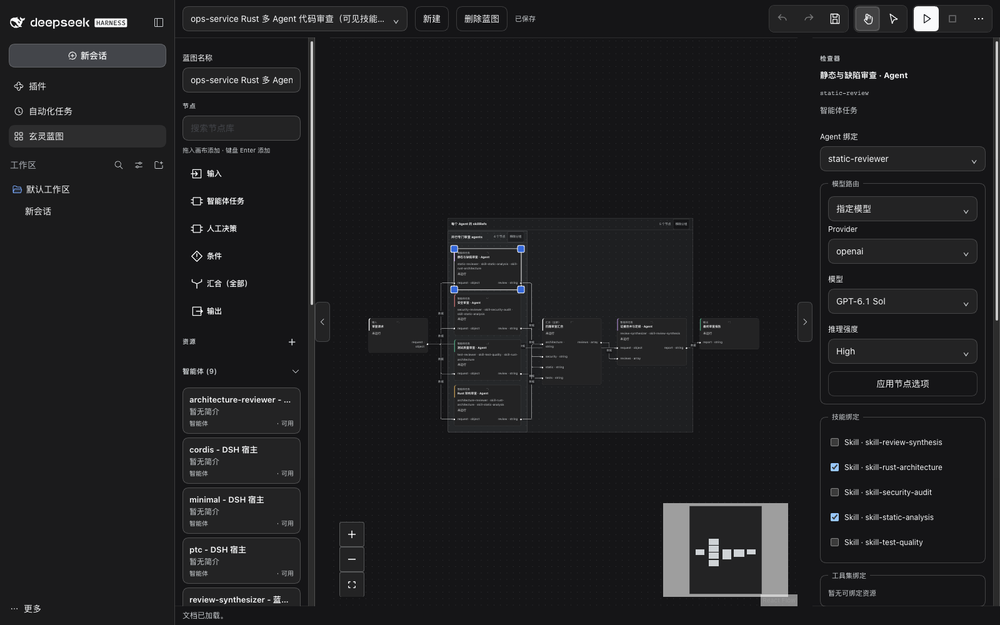

# 玄灵蓝图

[English](README.md) · `@xuanling-rs/xuanling-dsh-blueprint`

在 DeepSeek Harness 中构建可持久执行的智能体工作流。

玄灵蓝图（XuanLing Blueprint）为 DeepSeek Harness（DSH）增加图形编辑器与持久 Run 运行时。
在画布上连接输入、智能体任务、人工决策、条件、汇合（全部）和输出节点，绑定 DSH 现有的
Agent、Skill 与 MCP 工具，为每个智能体任务选择模型，然后查看 Host 记录下来的每次 Attempt。
DSH 负责模型、原生会话和工具权限；蓝图负责画布、保存的定义、资源快照和持久 Run 记录。


*本地 DSH Web profile 中的节点库、画布、资源侧栏与检查器。图中的工作流并行运行静态分析、
安全审查、测试质量审查和 Rust 架构审查，汇合四份审查结果后再写出综合报告。图中的流程是
已保存的示例，不是内置模板。截图使用中文界面；界面语言与明暗主题跟随 DSH 设置。*

## 功能概览

- **类型化图编辑。** 数据连线要求两端端口类型一致，拒绝数据环；控制连线驱动条件、人工决策
  和汇合。布局、固定、分组和端口显示只影响展示，不改变执行。
- **DSH 原生资源。** 绑定 profile 中已有的 Agent preset、Skill 和精确 MCP 工具身份。资源
  侧栏按 Agent、Skill、MCP 和其他资源分类。
- **按任务选择模型路由。** 保留 DSH 默认，或从 DSH 模型目录指定 Provider、模型和推理强度。
  每个新 Attempt 记录实际使用的路由。
- **持久 Run 与 Attempt。** 接纳 Run 时冻结定义版本与包内资源；每次派发先写入 intent，外部
  副作用完成后再写 result。刷新或查看 Run 不会重放工作。
- **执行前检查。** 运行前检查验证声明的资源、Host 工具绑定和源节点端口值；阻止项会拦截
  接纳，Run 启动时会再次检查。模型路由和下游值在 Attempt 执行时检查。
- **可移植工作流包。** 导出和导入的 ZIP 包含定义及其声明的自定义资源；凭据与机器专属配置
  转为目标环境的绑定要求。
- **可选 TeamStage。** 把一个智能体任务作为原生 DSH Agent Teams 阶段执行，并记录持久的任务、
  成员和产物事实。

## 环境要求

- 一个 DSH Web profile。当前开发与 CI fixture 使用 `next` 频道的 DSH `0.2.1-rc.2`；公开
  运行时 peer 下限为 `>=0.2.1-alpha.5`；兼容性预检会比较预发布版本。
- 含智能体任务的工作流需要在 DSH 中配置模型 Provider；输入 → 输出图不需要模型。
- 只有从源码构建插件时才需要 Node.js 22.14 或更新版本。
- 使用 TeamStage 时需另外显式启用原生 Agent Teams profile。

## 安装

把已发布包安装到提供 DSH Web 界面的同一个 profile：

```sh
dsh plugin --profile web add @xuanling-rs/xuanling-dsh-blueprint@0.6.1
```

重启该 profile 并刷新 DSH 页面。把 `web` 换成实际使用的 profile；新建的自定义 profile 只包含
基础 bundle，不会自动包含 Web 应用。

已发布的 `0.6.1` 包声明的是较早的 DSH `0.2.1-alpha.3` peer 集。在当前 DSH `next` 频道上运行
本版本时，请使用 [开发](#开发) 中的 checkout 链接构建。本 README 跟随当前 main 分支，已发布包
可能落后于它。

TeamStage 还需要显式启用原生 Agent Teams profile。

## 第一个工作流

1. 在 DSH 侧栏打开 **玄灵蓝图**，点击 **新建** 并填写名称。蓝图库为空时会自动打开新草稿；
   创建或保存蓝图都不会启动运行。
2. 从节点库把 **输入**、**智能体任务** 和 **输出** 拖到画布。双击空白画布也可打开节点搜索。
3. 逐个选择节点，在 **检查器** 中设置端口；修改后点击 **应用端口**。

   | 节点 | 输入端口 | 输出端口 |
   | --- | --- | --- |
   | 输入 | 无 | `request: string` |
   | 智能体任务 | `input: string` | `result: string` |
   | 输出 | `value: string` | 无 |

4. 连接 `输入.request → 智能体任务.input` 和 `智能体任务.result → 输出.value`。数据连线的
   两端类型必须一致。
5. 选中智能体任务，在 **Agent 绑定** 中选择 DSH 已有的 Agent preset。选择器先列出 DSH 资源，
   再列出蓝图资源；按需添加 **技能绑定** 和 **工具集绑定**。
6. 在 **模型路由** 中保留 **DSH 默认**，或选择 **指定模型**，然后从 DSH 模型目录选择
   Provider、模型和可选推理强度，再点击 **应用节点选项**。
7. 点击 **保存**。展开 **持久运行** 并填写运行输入 JSON，例如
   `{"request":"请摘要这段文字。"}`。打开 **更多操作 → 工具 → 检查并保存**，处理全部阻止项。
   编辑图或输入后，旧检查会过期，需要重新检查。
8. 点击 **运行**。运行按钮会先保存和检查。在 **持久运行** 中展开各 Attempt，查看输出、错误码
   和诊断。返回 Run ID 表示已接纳；`succeeded` 才是最终成功状态。

第一次练习不调用模型时，可直接用相同的 string 端口连接 `输入.request → 输出.value`，运行
所给 JSON，输出会保留文字内容。确认这条路径可运行后，再加入智能体任务。

智能体任务的检查器把节点绑定、端口声明和模型路由放在一起：



*Agent 绑定、从 DSH 模型目录读取的模型路由，以及技能绑定。*

## 示例流程：一份已保存的多 Agent 审查（非内置）

截图中的蓝图名为 `ops-service Rust 多 Agent 代码审查（可见技能版）`，来自本地 DSH profile。
它是示例，不是内置模板：插件不会随包分发这张图及其 Agent、Skill 资源。

图从 `review-request` 开始，分成静态与缺陷、安全、测试质量、Rust 架构四个智能体任务并行审查，
在 `parallel-reviews` 汇合 `review` 字符串，再把证据和原始请求交给 `synthesize-review`，
最后把 `report` 写入 `review-result`。服务该 profile 需要包含引用的 5 个 Agent 和 5 个 Skill。
该流程不需要 MCP 绑定，但需要可用的 DSH 模型。

1. 在 DSH Web profile 中打开 **玄灵蓝图**，选择这份已保存的示例。
2. 选中一个智能体任务。在 **Agent 绑定** 中确认引用的 Agent 与 Skill。在 **模型路由** 中保留
   **DSH 默认**，或选择 **指定模型**，从 DSH 模型目录选择 Provider、模型和推理强度，然后点击
   **应用节点选项**。
3. 确认端口和绑定后点击 **保存**。
4. 展开 **持久运行**，填写与 `review-request.request` 匹配的请求对象，打开
   **更多操作 → 工具 → 检查并保存**，处理全部阻止项。
5. 点击一次 **运行**。依次查看四个专门审查 Attempt、汇合、合并审查 Attempt 和最终
   `report` 输出。刷新页面只读取已记录的 Run 和 Attempt，不会重放模型或工具调用。

如果 profile 没有 Provider 凭据，Run 会以明确的运行前或 Provider 失败结束，已保存的蓝图不受
影响。若要自行搭建等价流程，可把 `examples/code-review` 当作可移植格式参考，并准备自己的
Agent 与 Skill 文件。

## Run 如何执行

接纳 Run 时写入精确的定义版本，冻结本次 Run 所需的包内资源，并在每个 Attempt 中解析共享资源
和 Host 资源。已就绪的节点并行执行。每个节点 Attempt 在外部副作用前记录 intent，在完成后记录
result；Host 无法确认的结果会进入 `recovery_required`（需要恢复），而不是伪造结果。

| Run 状态 | 含义 |
| --- | --- |
| `queued` | 已接纳，等待运行时启动。 |
| `running` | 至少有一个节点可执行或在途。 |
| `waiting_input` | 人工决策节点正在等待 **批准** 或 **拒绝**。 |
| `cancelling` | 已请求取消，正在中断并等待在途工作收尾。 |
| `recovery_required` | 外部副作用未知；Run 不会被自动重新派发。 |
| `succeeded` / `failed` / `cancelled` / `timed_out` | 终态；终态不可变。 |

- 节点失败后停止派发新节点，中断并等待在途兄弟节点收尾。即使取消竞态同时发生，已记录的失败
  仍是 Run 结束的原因。
- 人工决策和 TeamStage 节点在等待人工或原生 Team 状态时独占 Run。
- Host 重启后，已派发但没有记录结果的 Attempt 会重新进入 `recovery_required`。再次运行前，
  由 Host 运维者核对外部副作用；蓝图不会自动重放未知副作用。
- **取消运行** 只是请求取消，最终以记录的持久状态为准；查看和刷新页面不会重放模型或工具调用。
- **删除蓝图** 会保留既有 Run 及其历史，也不会取消正在执行的 Run。

彼此独立的已就绪节点并行执行。插件配置 `maxConcurrentNodes` 默认是 `4`，取值为正安全整数；
设为 `1` 可串行执行。节点完成后立即释放槽位，较快分支无需等待无关的慢分支。共享同一 runtime
的多个 Run 仍按顺序排队。

## 画布、资源与检查器

**检查器** 显示所选节点的端口、资源和选项。智能体任务显示 Agent、Skill、工具集、输出 schema
和模型路由控件。输入、输出、条件、汇合和人工决策节点隐藏执行型绑定；定义中已有的引用仍会保留，
并继续由 Host 运行前检查约束。没有声明工具集的节点没有业务工具；所选工具仍受 Host 权限和审批
约束。运行前检查不证明 MCP 已连通或已获得审批。

**端口显示与连线** 可分别开关控制输入、数据输入和数据输出。开关只影响显示和是否允许新连线，
不会删除端口声明、执行顺序、数据传递或已有边；某一方向已有连线时会保持显示，必须先断开该边
才能关闭。

**分组** 与布局元数据只影响展示。分组标题保留独立标题区域，节点实际测量尺寸参与碰撞处理；
首次打开和 **适应视图** 会把分组标题纳入可见范围。运行时蓝图使用 Host 剩余的画布高度，并且
是只读的：拖动、缩放、刷新和适应视图不会保存布局、启动 Run、取消 Run 或重试 Run。

**资源** 侧栏固定分为 Agent、Skill、MCP 和其他资源。点击资源库旁的 **+** 打开新增资源弹窗；
点击已有资源可查看详情。弹窗显示资源类型、逻辑 ID、显示名称、简介、来源、可用性、公开配置
摘要和高级 JSON。**应用** 会写入一次蓝图编辑历史；**取消** 和 Escape 不会留下部分写入。Host
资源不可编辑时以查看模式显示。

资源详情不会读取或展示 Host URL、headers、环境变量、secret、原始 Skill 正文或私有 MCP 配置；
打开资源详情也不会探测或调用 MCP。Host 目录加载中或不可用时，已有引用会保留并显示为未知或
不可用，不会被静默替换。

## 两个工作入口

| 入口 | 用途 |
| --- | --- |
| 侧栏 **玄灵蓝图** | 创建和编辑图、选择资源、保存、检查、运行并查看结果。 |
| 原生对话中的 **蓝图** 视图 | 只读查看与该对话关联的冻结图和 Attempt。 |

普通对话会显示 **当前对话未关联蓝图**，这是正常空态。要从该对话建立运行关联，需要在该对话中让 Agent
显式启动蓝图；侧栏启动的 Run 不会自动关联当前聊天。读取失败和离线连接有各自的加载与错误状态。

在对话的蓝图视图中，点击只有一次 Attempt 的智能体节点会打开对应原生聊天，运行中和完成后都可
查看。存在多次 Attempt 时，在目标记录上选择 **查看聊天记录**。侧栏运行详情和 Team 成员也提供
聊天入口。没有可验证会话的旧记录会提示聊天不可用。

同一次调用内的自动重试会跟随该 Attempt 的最终结果。节点已经失败后，即使主聊天继续处理任务，
旧失败记录仍会保留。失败说明中的 **返回主聊天** 可查看后续处理；从侧栏独立启动、没有来源聊天
的 Run 不显示该入口。

## 审批与 TeamStage

**人工决策** 节点会让 Run 进入 `waiting_input`。在侧栏的 **持久运行** 区使用 **批准** 或
**拒绝**。**批准** 会把节点记录为成功并恢复 Run；**拒绝** 会记录决定并取消 Run。

TeamStage 把一个智能体任务作为原生 DSH Agent Teams 阶段执行，需要预先准备
`agentTask.teamStage` 定义、包内 Markdown Agent 资源、原生 Team 能力和来源 Lead 对话。画布
分组不会创建 Team；成员使用独立的模型合同。

## 用原生对话创建蓝图

根对话可通过原生工具创建并启动蓝图：

| 工具 | 用途 |
| --- | --- |
| `blueprint_describe` | 读取当前 schema、可执行节点类型、示例和 Host 工具绑定；传入 ID 时读取已保存的图和版本。 |
| `blueprint_list` | 列出已配置的蓝图及其当前文档版本。 |
| `blueprint_validate` | 校验候选定义及其声明的文本文件，不保存也不运行。 |
| `blueprint_create` | 原子保存新蓝图及其声明的资源文本文件；不启动运行。 |
| `blueprint_preflight` | 对已保存版本和输入执行只读检查。 |
| `blueprint_start` | 用当前版本和 JSON 输入值显式启动已保存蓝图。 |
| `blueprint_inspect` | 读取与该对话关联的冻结 Run。 |

示例请求：

```text
先调用 blueprint_describe 获取当前 schema 和 AgentTask 示例。
创建“输入 → 智能体任务 → 输出”的文本摘要蓝图，明确声明 Agent 资源并提供指令文件。
用 blueprint_validate 校验 definition 和 files，再用稳定的 requestId 调用
blueprint_create 保存。返回 blueprintId 和 documentRevision，先不要启动运行。
```

查看保存的图后，提供实际文本，再要求 Agent 调用 `blueprint_preflight`，通过后对该版本只调用
一次 `blueprint_start`。两个工具的 `input` 都是 JSON 值，例如
`{"request":"待摘要的实际文本"}`。后续用 `blueprint_inspect` 查看；打开或刷新视图不会再次运行。
输入只供给已有节点，不会创建 Agent。

`blueprint_describe` 直接提供当前 schema 和创建示例，无需另行下载文档。`blueprint_create`
会同时保存定义和声明的文本资源文件；画布中的资源表单只声明引用，不会创建包内 Agent、Skill
或 schema 的文件正文。

## 分享与迁移

打开 **更多操作 → 文件** 可导出或导入完整 ZIP：

- **导出 ZIP 包** 先保存编辑，再打包声明的资源。自定义 DSH Agent preset、完整 Skill 目录和
  MCP 定义都会随包导出。只有已证明来自 DSH 官方内置的资源不导出正文，保留逻辑引用；来源
  未知时也必须物化，不能安全打包时导出会明确失败。
- 凭据和机器专属配置不进入包，会转为目标环境的 `requiredBindings`。运行前需配置目标模型、
  资源根和精确 MCP 工具；导入后再导出仍保留这些绑定要求。
- **导入 ZIP 包** 需要已配置的空目标，且目标 ID 与包内蓝图 ID 一致。导入不会覆盖非空目标、
  激活包内插件、连接 MCP，也不包含 Run 历史。

## 排错

| 现象 | 操作 |
| --- | --- |
| 侧栏没有蓝图入口 | 确认当前 profile，重启该 profile 后刷新 DSH。 |
| 对话未关联蓝图 | 正常空态；使用侧栏，或在该对话中让 Agent 显式启动 Run。 |
| 有阻止项或缺少资源 | 查看 **运行前检查**，补齐依赖后重新检查。 |
| 运行时出现 Provider 或模型错误 | 在 DSH 中配置模型 Provider，然后重新检查并运行。 |
| 检查已过期 | 保存当前图和输入，再检查一次。 |
| 等待输入 | 在侧栏的持久运行区选择 **批准** 或 **拒绝**。 |
| 离线或读取失败 | 恢复连接后刷新或重连；查看已确认的 Run 事实。 |
| `recovery_required` | 保留 Run ID，由 Host 运维者核对外部副作用后再决定下一次运行。 |
| 导入被拒绝 | 目标必须已配置、为空，且与包内蓝图 ID 一致。 |

## 限制

- 定义词汇只包含输入、智能体任务、人工决策、条件、汇合（全部）和输出。已移除的
  `toolCall`、`scriptCall`、节点 `subflow`、`iteration`、`汇合（任意）`，以及节点字段
  `budget`、`subflowRef` 都是硬断代：重新读取旧蓝图或 Run 定义时，在解码边界返回带类型的
  `blueprint/definition-invalid`。`ResourceKind=subflow` 仍用于可移植的嵌套蓝图资源；它不是可执行节点。
- 绑定输出 schema 时，输出必须通过 DSH 接受的结构化捕获；普通回复中的 JSON 不能满足 schema
  合同。
- 没有声明工具集的智能体任务没有业务工具。所选工具仍受 Host 权限和审批约束，运行前检查不
  证明 MCP 已连通。
- TeamStage 是可选能力，不能由画布分组创建。
- Run 记录是持久事实，会持续保留；删除蓝图不会删除它们。

## 开发

从本 checkout 构建插件，把目录链接进提供 Web 界面的 profile，然后只启动 Web 应用：

```sh
BLUEPRINT_DIR=/absolute/path/to/xuanling/integrations/deepseek-harness/xuanling-blueprint
pnpm --dir "$BLUEPRINT_DIR" install --frozen-lockfile
pnpm --dir "$BLUEPRINT_DIR" build
dsh plugin --profile web add "link:$BLUEPRINT_DIR"
dsh --profile web --no-open
```

每次重新构建后重启 Web profile，使插件 bundle 重新加载。链接 profile 直接读取 checkout 中的
`lib/`，不使用已发布包。`link:` 安装是加载 checkout 的开发工作流，常规安装使用已发布包。
本 README 中的截图来自该链接构建。

检查命令：

```sh
pnpm --dir "$BLUEPRINT_DIR" typecheck
pnpm --dir "$BLUEPRINT_DIR" lint
pnpm --dir "$BLUEPRINT_DIR" test
```

确定性 suite、浏览器 fixture 和真实 Host journey 的前置条件与证据边界各不相同，见
[CI-VALIDATION.md](CI-VALIDATION.md)。浏览器 fixture 需要 `test/blueprint` 下的隔离 harness，
并安装 Playwright 浏览器。

更多安装配置见
[DSH 集成说明](https://github.com/umbrella22/xuanling/blob/main/integrations/deepseek-harness/README-ZH.md)。
[代码审查定义](https://github.com/umbrella22/xuanling/blob/main/integrations/deepseek-harness/xuanling-blueprint/examples/code-review/blueprint.json)
是可移植格式参考；使用前须准备资源文件和 Host 绑定。

## 许可

MIT
