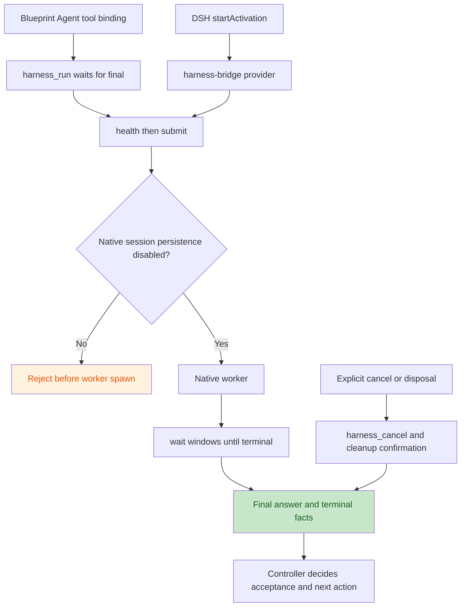

# Harness Bridge for DeepSeek Harness

A local, private integration package. It registers the `harness-bridge` DSH
subagent provider and the blocking `harness_run` tool. Each invocation starts
one Bridge process, submits one self-contained task, waits for its terminal
result and releases the process. Only final output and terminal/delivery facts
cross this boundary. No task database, native worker transcript, progress log,
automatic retry, model fallback or inference deadline is added.

`harness_run` returns the full Bridge final result. A Blueprint node waits for
that result before continuing. The provider returns DSH's standard one-shot
`SubagentRun`; DSH handles child identity, result delivery and parent wake-up.
Neither route supports steering, session resume, inherited parent history,
`agentPreset`, `agentOptions`, `outputSchema` or `maxDepth`.



## Configuration

Build the native executables from the repository root:

```sh
cargo build -p xuanling-harness-bridge --bins
```

Install dependencies in this directory with `npm ci --ignore-scripts
--legacy-peer-deps`. The DSH services are host peers. For a local profile, the
plugin row can point at this directory's absolute `index.mjs` path, with the
following config:

```yaml
- insert:
    - id: xuanling-harness
      name: /absolute/path/to/xuanling/integrations/deepseek-harness/xuanling-harness/index.mjs
      config:
        command: /absolute/path/to/xuanling/target/debug/harness-bridge
        configPath: /absolute/path/to/bridge-config.json
        adapter: codex
        workspaceId: default
        providerName: harness-bridge
        toolName: harness_run
        saveResult: false
```

The [Bridge configuration](../../../crates/xuanling-harness-bridge/config.example.json)
supplies the trusted absolute worker program, CLI model/permission policy and
`workspaces.default` root. The caller's effective DSH working directory must
resolve to exactly that root. A different directory, including a child
directory, returns `WORKSPACE_MISMATCH` before starting Bridge; the Bridge MCP
contract cannot represent a different worker cwd. Configure another instance
with distinct provider/tool names for another adapter or workspace.

Codex always receives `--ephemeral`; Claude Code always receives
`--no-session-persistence`. DSH and ZCode workers currently reject with
`NATIVE_SESSION_PERSISTENCE_UNSUPPORTED`: their existing adapter invocations
have no verified persistence suppression. DSH remains supported as the
controller. An older Bridge that omits
`native_session_persistence_disabled: true` also rejects before submit.

The adapter reads only the trusted Bridge config to resolve the workspace.
The SDK passes its standard baseline environment to Bridge. Optional `env`
adds explicit string values from the trusted profile; Bridge separately
applies `env_allowlist`/`secret_env` before spawning the worker. Error messages
from the MCP client and raw Bridge stderr are never copied to the parent.

The optional generic DSH delegation tool can use this provider:

```yaml
- insert:
    - id: tool-subagent-harness
      name: '@deepseek-ai/dsh-tool-subagent'
      config:
        provider: harness-bridge
        toolName: subagent_harness
        maxDepth: provider-managed
```

This requires that package in the selected profile. `subagent_harness` returns
an asynchronous child identity; DSH delivers the final notice. The provider
has no continuable child session, so native Agent Teams/Blueprint TeamStage,
which require continuation and member messaging, cannot use it.

## Blueprint binding

Add one exact tool binding to the existing Blueprint configuration:

```yaml
toolBindings:
  native-worker:
    tools: [harness_run]
```

Declare that binding in the definition and grant it to the chosen Agent node:

```json
{
  "resources": {
    "nativeWorker": { "kind": "mcp", "bindingId": "native-worker" }
  },
  "graph": {
    "nodes": [
      { "id": "work", "kind": "agentTask", "agentRef": "worker", "toolsetRefs": ["nativeWorker"] }
    ]
  }
}
```

Merge these fragments into an existing definition containing its `worker`
Agent resource. The node's Agent calls `harness_run({"prompt":"<complete
task>"})` and receives `status`, `worker_final_output`, `output_complete`,
`cleanup`, errors and optional report fields. A returned tool value includes
failed/cancelled terminals; it does not assert successful work. The
controller validates these facts and the answer before accepting or advancing.

The tool has no `timeoutMs`. Each `harness_wait` uses a 30-second observation
window with a separate 60-second MCP RPC bound. A `pending` response repeats
the wait for the same job. No worker runtime deadline is sent. Explicit
node/host cancellation stops this invocation's worker. Each invocation has a
separate Bridge process, so Bridge capacities and request dedupe are local to
that invocation; DSH/Blueprint controls cross-invocation concurrency.

## Storage and failure behavior

- Adapter handles and Bridge job state are in memory. The adapter reads no
  native worker session and writes no execution record.
- `saveResult` defaults to false. True requests Bridge's existing one-file
  terminal Markdown export; report failures do not rerun the worker.
- DSH's parent conversation/catalog and Blueprint's existing Run evidence
  remain part of those controllers. Disabling worker transcripts does not
  disable controller records, worker authentication, product caches or task
  source/output writes. This is not a zero-disk-IO guarantee.
- Startup errors clean up unpublished work before rejecting. Cancellation
  during submit first captures the accepted job id, then cancels that job.
  Plugin disposal waits for in-flight acceptance and settles active jobs.
  A lost submit response returns `CLEANUP_UNCONFIRMED`; transport shutdown
  cannot prove whether acceptance or worker side effects already occurred.
- Published provider results resolve to `completed`, `aborted` or `error`.
  Incomplete output, delivery/report errors and unconfirmed cleanup never
  produce `completed`. Diagnostics use fixed protocol vocabulary. A transport
  fault never reconnects or resubmits; unconfirmed cleanup rejects disposal.

## Local verification

```sh
# repository root
cargo build -p xuanling-harness-bridge --bins
# this directory
npm test
npm run test:blueprint
```

The Blueprint test requires its sibling package's development dependencies
and Node 22/24 with `--experimental-transform-types`, matching Blueprint's
source test harness. The adapter itself runs as JavaScript on Node 22.14+.
Tests exercise real stdio Bridge and a compiled fake native worker. Blueprint
tests use its production driver and real DSH Tools/SubagentRuntime with a
scripted model turn. They do not prove provider calls, installed desktop UI,
cross-process notification recovery or an npm registry release.
